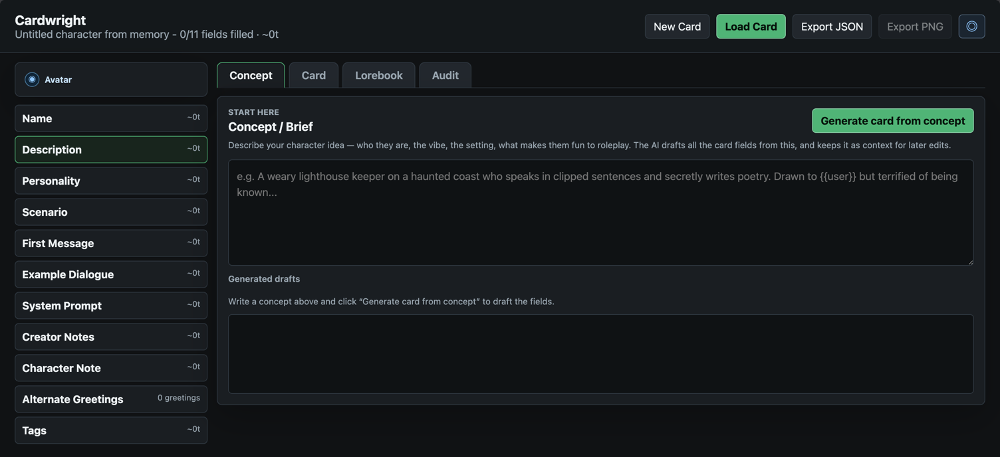

# Cardwright

**Current version:** 1.2.0

A small standalone character card editor (and lorebook authoring tool) focused on one workflow:



Additional documentation:

- [User Guide](USER_GUIDE.md)

1. Start a blank card with **New Card** (lands on the **Concept** tab), or load an existing one. Your work is auto-saved to the browser and restored on the next visit.
2. In the **Concept** tab, describe your character idea, optionally select a **User Persona**, and click **Generate card from concept** - the AI drafts every field for you to review and apply. Persona presets support separate JSON backup/import. The concept is saved and fed into all later AI edits.
3. Edit the card fields directly. (Or skip the concept and load an existing card from `.json` or a metadata-bearing `.png`.)
4. Edit the embedded lorebook (`character_book`): add/remove entries, keywords, secondary keys, position, order, and constant/triggered settings.
5. Run a local, offline **Audit** (no AI call) that checks required fields, token budgets, placeholder text, `{{user}}` impersonation, and lorebook health, scoring the card out of 100. Field-level issues can be sent to AI as reviewable fix drafts.
6. Ask LM Studio, oMLX, Ollama, OpenAI, or another OpenAI-compatible model to revise one selected field, improve a lorebook entry, or audit the card.
7. Set an avatar image and crop it to the 2:3 portrait ratio used by character cards.
8. Export the edited card - lorebook included - as JSON, **or as a PNG** with the card embedded in a `chara` tEXt chunk (re-imports here and in SillyTavern).

### Avatar & PNG export

- **Set / Crop Image** (sidebar) opens any image in a 2:3 crop dialog. When you load a `.png` card its image becomes the avatar automatically.
- **Export PNG** (top bar) writes the current card (fields + lorebook) into the avatar PNG. The result loads straight back into this tool or SillyTavern.
- **Generate Avatar Prompt** asks the selected AI provider for a text prompt based on the card. Edit the result and copy it into your image generator; it does not generate an image.

The editor is split into four tabs:

- **Concept** - your idea/brief and one-click card generation.
- **Card** - the character fields, with live token estimates per field.
- **Lorebook** - the embedded World Info entries.
- **Audit** - the offline quality report; each field-level issue links straight to the field it concerns and can generate an AI fix draft.

Token counts are estimates (~4 characters per token) since no model tokenizer runs offline.

The sidebar **Placeholders** selector supports `{{char}} / {{user}}` (default),
`{char} / {user}`, and `{character} / {user}`. Generation uses your selection;
edits preserve the target's existing tokens. All forms are understood by the
audit. The preference is saved locally with the card, stays out of exports,
and resets to the default for new or imported cards without converting text.

## Run

Windows:

```text
start-windows.bat
```

macOS/Linux:

```bash
./start-macos.sh
```

Manual:

```bash
node server.mjs
```

or:

```bash
npm start
```

Then open:

```text
http://127.0.0.1:8787
```

You can override the port with `PORT=...`, but the default is `8787`.

## AI provider setup

Open the settings button (`◎`) in the top bar, choose a provider, then click
**Detect Model** or **Test**.

Supported provider presets:

- **LM Studio:** `http://127.0.0.1:1234/v1`
- **oMLX:** `http://127.0.0.1:8000/v1` (API key can be required by oMLX)
- **Ollama:** `http://127.0.0.1:11434/v1`
- **OpenAI:** `https://api.openai.com/v1` (API key required)
- **Custom:** any OpenAI-compatible `/v1` endpoint

For LM Studio:

1. Load a chat/instruct model.
2. Start the local server.
3. Choose **LM Studio** and click **Detect Model**.

The API key can stay blank for LM Studio. The default model value is
`local-model`, but the app automatically asks LM Studio for `/v1/models` and
fills the model field with the detected chat model.

An explicitly selected or entered model is preserved on reload and during AI
requests. **Detect Model** explicitly selects a detected model; **Test** keeps
your current choice. Switching provider or changing the base URL clears the
previous API key, so enter the key for the new endpoint if required.

For oMLX, start its OpenAI-compatible server, choose **oMLX**, and paste the
oMLX API key if your oMLX server requires one.

## Environment setup

You can either:

- enter an API key in the app's Settings panel for hosted providers, or
- set environment variables before starting the server. The app reads
  `OPENAI_PROVIDER`, `OPENAI_BASE_URL`, and `OPENAI_MODEL` as its defaults;
  `OPENAI_API_KEY` stays server-side and is used when the API key field is blank
  and the request targets the configured endpoint:

```bash
OPENAI_PROVIDER=openai OPENAI_API_KEY=sk-... node server.mjs
```

Optional environment variables:

```bash
OPENAI_PROVIDER=lmstudio
OPENAI_BASE_URL=http://127.0.0.1:1234/v1
OPENAI_MODEL=local-model
PORT=8787
```

Any chat-completions-compatible provider should work if its base URL follows the
`/v1/chat/completions` shape.

The server accepts local clients only, validates the browser origin and Host,
and serves only the app's public assets. Repository files such as `.env`,
`.git/config`, and `server.mjs` are not public. Browser API requests use JSON;
provider redirects are rejected, so configure the final provider URL directly.
Keys entered in Settings remain in this browser's local storage until cleared
or the provider/endpoint is changed. Server environment keys are never returned
to the browser and are not reused for another endpoint.

## Audit and shutdown

The Audit tab includes a local offline audit, a full-card AI audit, and a
separate lorebook AI audit. AI audit results are kept in the browser session for
the current card.

To stop the server, use the `Stop Server` button in Settings. You can also
press `Ctrl+C` in the terminal where `node server.mjs` is running.
